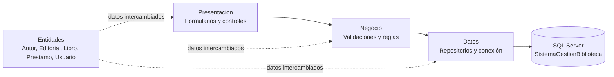
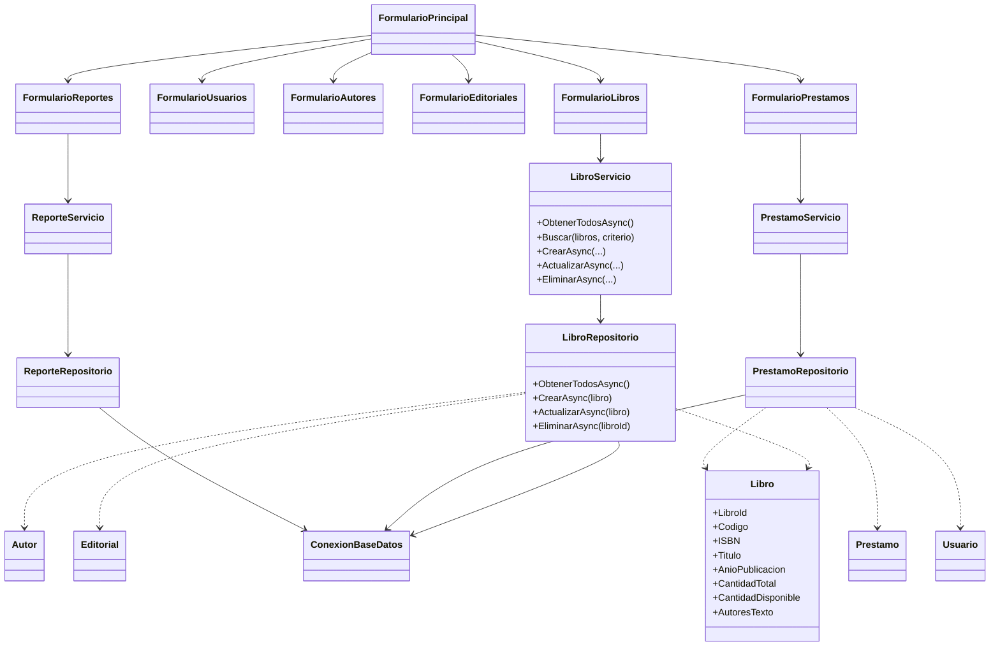
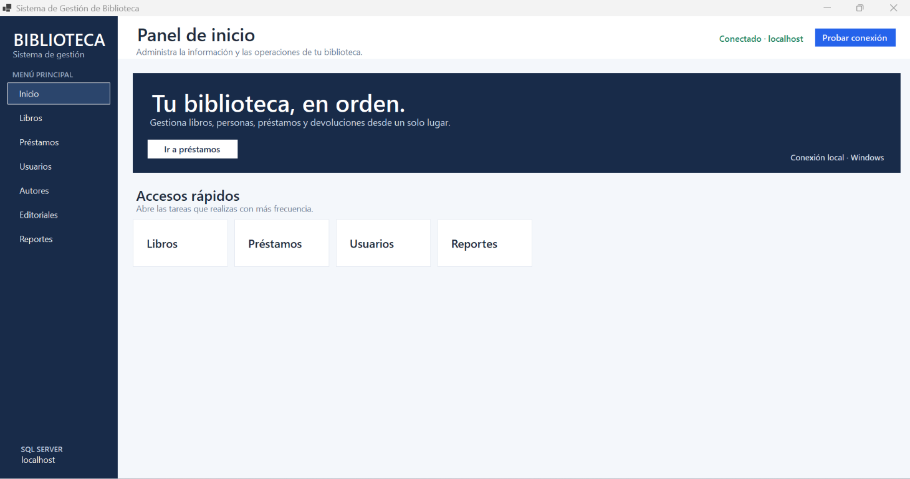
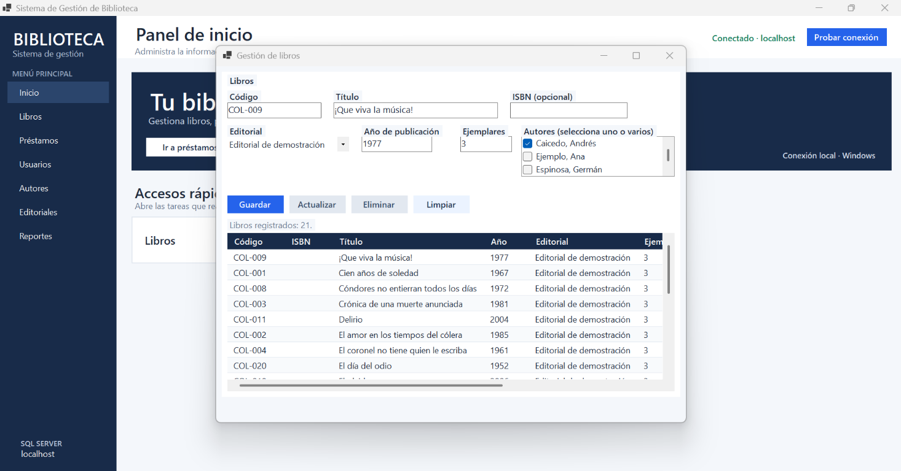
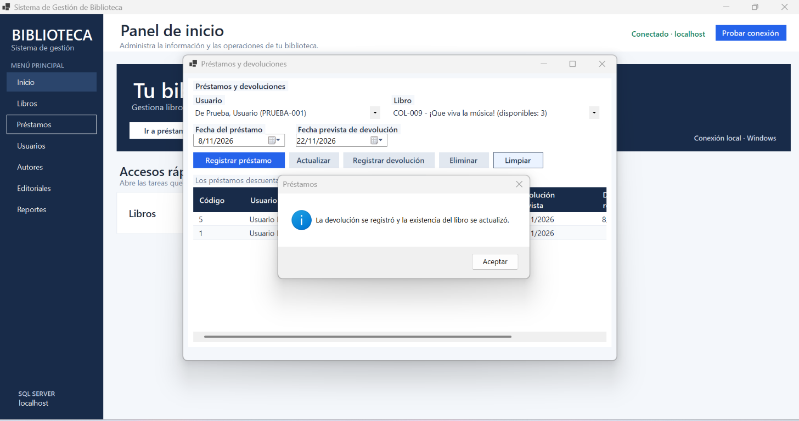
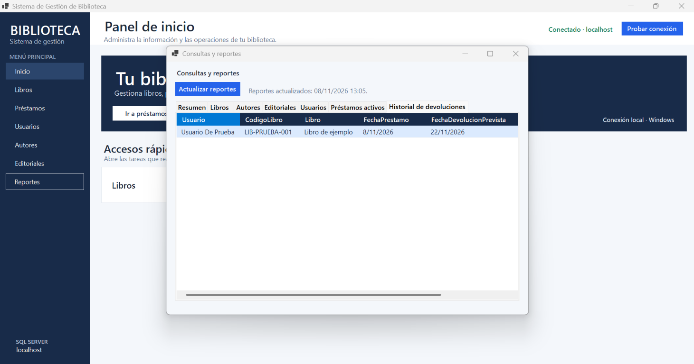

## Portada

**Corporación Unificada Nacional de Educación Superior (CUN)**<br>
**Ingeniería de Sistemas**<br>
**ACA — Programación Avanzada**

# Sistema de Gestión de Biblioteca

Documento técnico del proyecto

**Estudiante:** Miguel Ángel Maldonado Mosquera<br>
**Docente:** Veronica Castro Munar<br>
**Ciudad:** Bogotá<br>
**Año:** 2026

<div style="page-break-after: always;"></div>

## Tabla de contenido

1. [Introducción](#1-introducción)
2. [Objetivos](#2-objetivos)
3. [Planteamiento del problema](#3-planteamiento-del-problema)
4. [Análisis de requerimientos](#4-análisis-de-requerimientos)
5. [Casos de uso](#5-casos-de-uso)
6. [Diseño y arquitectura](#6-diseño-y-arquitectura)
7. [Modelo entidad-relación y diccionario de datos](#7-modelo-entidad-relación-y-diccionario-de-datos)
8. [Módulos desarrollados](#8-módulos-desarrollados)
9. [Conexión con SQL Server](#9-conexión-con-sql-server)
10. [Pruebas de funcionamiento](#10-pruebas-de-funcionamiento)
11. [Capturas de pantalla](#11-capturas-de-pantalla)
12. [Conclusiones](#12-conclusiones)
13. [Recomendaciones](#13-recomendaciones)
14. [Referencias](#14-referencias)
15. [Contraportada](#15-contraportada)

## 1. Introducción

El Sistema de Gestión de Biblioteca es una aplicación de escritorio desarrollada como trabajo final de ACA — Programación Avanzada. Permite administrar el catálogo bibliográfico, sus autores y editoriales, las personas usuarias, los préstamos y las devoluciones. También proporciona consultas para revisar el inventario y los movimientos de la biblioteca.

La aplicación está desarrollada en C# con Windows Forms sobre .NET 10 y utiliza SQL Server para almacenar la información. El código está organizado en capas dentro de un único proyecto de Visual Studio. Esta separación permite distinguir la interfaz, las reglas de negocio, el acceso a datos y las entidades del sistema.

La implementación aplica conceptos de programación orientada a objetos, validación de datos, relaciones e integridad referencial en una base de datos relacional. Windows Forms proporciona los formularios y controles de escritorio utilizados para la interacción con la persona usuaria (Microsoft, 2025).

## 2. Objetivos

### 2.1. Objetivo general

Desarrollar una aplicación de escritorio para administrar libros, autores, editoriales y usuarios, gestionar préstamos y devoluciones y consultar reportes conectados a una base de datos relacional.

### 2.2. Objetivos específicos

- Organizar el código en capas de presentación, negocio, datos y entidades.
- Implementar operaciones de registro, consulta, actualización y eliminación en los módulos definidos.
- Validar los datos y las relaciones antes de guardarlos.
- Mantener sincronizadas las existencias de libros y los préstamos mediante transacciones.
- Presentar consultas consolidadas para apoyar la administración de la biblioteca.
- Utilizar Git y GitHub para registrar la evolución del proyecto.
- Documentar la instalación, la ejecución, el modelo de datos y las pruebas.

## 3. Planteamiento del problema

La administración de una biblioteca educativa requiere conservar información relacionada sobre obras, autorías, editoriales, personas usuarias y movimientos de préstamo. Si estos datos se llevan sin un sistema centralizado, se dificulta encontrar libros, comprobar la disponibilidad de ejemplares y conocer si un préstamo sigue activo o ya fue devuelto.

Se requiere una aplicación que reúna esas operaciones en una interfaz de escritorio y almacene la información de forma consistente. El sistema debe validar los datos, impedir relaciones inválidas y ofrecer consultas útiles para revisar el estado de la biblioteca.

## 4. Análisis de requerimientos

Los siguientes requerimientos corresponden a la consigna del proyecto y a las funcionalidades implementadas. La consigna denomina «Gestión de Categorías» al requerimiento RF03, pero el alcance y la implementación describen la administración de editoriales; por ello, el módulo se presenta como **Editoriales**.

| Código | Requerimiento | Implementación |
|---|---|---|
| RF01 | Registrar, consultar, actualizar, eliminar y buscar libros; relacionarlos con autores y editoriales, y consultar existencias. | Implementado. La búsqueda filtra por código, título, ISBN o autor, sin distinguir mayúsculas y minúsculas. |
| RF02 | Administrar autores y proteger las relaciones con libros. | Implementado. No permite eliminar autores asociados a libros. |
| RF03 | Administrar editoriales y proteger las relaciones existentes. | Implementado. No permite eliminar editoriales que tengan libros. |
| RF04 | Administrar usuarios y sus datos de contacto. | Implementado. Valida documento y correo; protege usuarios relacionados con préstamos. |
| RF05 | Registrar, consultar, actualizar y eliminar préstamos; mostrar su estado y relaciones. | Implementado. Las operaciones de actualización y eliminación aplican reglas de inventario. |
| RF06 | Registrar devoluciones, cambiar el estado y actualizar existencias. | Implementado. La fecha real determina el estado; la devolución y reposición se guardan en una transacción. |
| RF07 | Consultar información consolidada de la biblioteca. | Implementado. Incluye resumen, catálogo, autores, editoriales, usuarios, préstamos activos e historial de devoluciones. |
| RF08 | Navegar entre los módulos de la aplicación. | Implementado desde el formulario principal. |

### 4.1. Requerimientos no funcionales atendidos

- Interfaz de escritorio organizada por módulos.
- Validación de campos obligatorios, fechas, cantidades y relaciones.
- Restricciones de unicidad para códigos, documentos y otros datos configurados.
- Consultas parametrizadas para separar valores de la instrucción SQL.
- Manejo de excepciones y mensajes de confirmación o error en la interfaz.
- Integridad referencial mediante claves primarias y foráneas. Estas restricciones mantienen válidas las relaciones entre tablas (Microsoft, 2024).
- Código organizado y documentado en español.

## 5. Casos de uso

**Actor principal:** persona encargada de administrar la biblioteca.

| Caso de uso | Precondiciones | Flujo principal | Resultado |
|---|---|---|---|
| Administrar libros | Existe conexión a la base; para registrar un libro, hay autores y editoriales. | Registrar, listar, buscar, seleccionar para editar o solicitar eliminación. | La información bibliográfica y sus relaciones quedan guardadas, o se presenta el motivo por el que una operación no puede completarse. |
| Buscar libros | El catálogo está cargado. | Escribir un fragmento del código, título, ISBN o autor; limpiar el criterio para restaurar el catálogo. | La tabla muestra las coincidencias o informa que no hay resultados. |
| Administrar autores | Existe conexión a la base. | Registrar, consultar, actualizar o solicitar eliminación. | Se guardan los cambios o se impide eliminar un autor relacionado con libros. |
| Administrar editoriales | Existe conexión a la base. | Registrar, consultar, actualizar o solicitar eliminación. | Se guardan los cambios o se impide eliminar una editorial relacionada con libros. |
| Administrar usuarios | Existe conexión a la base. | Registrar, consultar, actualizar o solicitar eliminación. | Se guardan los cambios o se protege el usuario relacionado con préstamos. |
| Registrar préstamo | Existen usuario, libro y al menos un ejemplar disponible; las fechas son válidas. | Seleccionar usuario y libro, definir fechas y confirmar el registro. | Se crea el préstamo y se descuenta una unidad disponible en la misma transacción. |
| Registrar devolución | Existe un préstamo activo. | Seleccionar el préstamo y confirmar la fecha real de devolución. | El préstamo pasa a devuelto y se repone una unidad en la misma transacción. |
| Consultar reportes | Existe conexión a la base. | Abrir una pestaña del módulo y actualizar los reportes. | Se muestran datos consolidados o un mensaje que informa del error de conexión. |

## 6. Diseño y arquitectura

### 6.1. Arquitectura por capas

La solución tiene un único proyecto WinForms: `SistemaGestionBiblioteca/SistemaGestionBiblioteca.csproj`. Dentro de él se agrupan estas capas:



- **Presentación:** muestra los formularios y recoge las acciones de la persona usuaria.
- **Negocio:** valida los datos y aplica reglas antes de guardar.
- **Datos:** ejecuta consultas parametrizadas contra SQL Server.
- **Entidades:** representan la información que se comparte entre las capas.

La separación evita que la interfaz ejecute instrucciones SQL directamente. Las transacciones de préstamos, devoluciones y cambios relacionados de inventario ayudan a conservar consistencia cuando intervienen varias instrucciones.

### 6.2. Diagrama de clases

El siguiente diagrama resume las dependencias principales del código. Cada módulo CRUD sigue el mismo patrón servicio/repositorio/entidad.



### 6.3. Estructura de archivos relevante

- `SistemaGestionBiblioteca.slnx`: solución que abre el proyecto.
- `SistemaGestionBiblioteca/SistemaGestionBiblioteca.csproj`: configuración del proyecto Windows Forms para `net10.0-windows` y referencia a `Microsoft.Data.SqlClient`.
- `SistemaGestionBiblioteca/App.config`: cadena de conexión de la aplicación.
- `SistemaGestionBiblioteca/Presentacion/`: inicio, navegación, formularios y estilos compartidos.
- `SistemaGestionBiblioteca/Negocio/`: servicios para autores, editoriales, libros, usuarios, préstamos y reportes.
- `SistemaGestionBiblioteca/Datos/`: conexión y repositorios SQL de cada módulo.
- `SistemaGestionBiblioteca/Entidades/`: clases de autor, editorial, libro, préstamo y usuario.
- `BaseDatos/`: scripts de creación y de datos de demostración.
- `Documentacion/`: modelo de datos, guía del código, informe de pruebas y capturas.

## 7. Modelo entidad-relación y diccionario de datos

El modelo completo, su diccionario de datos y las relaciones se encuentran en [ModeloDeDatos.md](./ModeloDeDatos.md). Las entidades centrales son:

- **Autores** y **Libros** se relacionan de muchos a muchos mediante `LibroAutores`.
- **Editoriales** y **Libros** se relacionan de uno a muchos.
- **Usuarios** y **Libros** se relacionan por los registros de **Prestamos**.
- Cada préstamo tiene fechas de préstamo, devolución prevista y, cuando se devuelve, fecha real.
- `Prestamos.Estado` es una columna calculada: si no hay fecha real, es `Prestado`; si la hay, es `Devuelto`.
- `Libros.CantidadDisponible` debe corresponder al total menos los préstamos activos.

Las claves primarias identifican cada registro y las claves foráneas hacen cumplir las relaciones. Las restricciones y los índices están definidos en `BaseDatos/01_CrearBaseDatos.sql`.

## 8. Módulos desarrollados

### Inicio y navegación

`FormularioPrincipal` presenta el menú, los accesos a módulos y el estado de conexión. La conexión se puede probar desde la pantalla.

### Libros

Permite registrar, listar, editar y eliminar libros. Cada libro puede relacionarse con una editorial y uno o varios autores. La búsqueda instantánea acepta fragmentos de código, título, ISBN o autor y no distingue mayúsculas de minúsculas.

### Autores y editoriales

Permiten registrar, consultar, actualizar y eliminar registros cuando no se rompa la integridad referencial. No se eliminan autores asociados con libros ni editoriales que publiquen libros.

### Usuarios

Permite administrar nombre, apellido, documento, teléfono y correo opcional. Se valida el documento y el formato del correo; no se elimina un usuario con préstamos registrados.

### Préstamos y devoluciones

El préstamo valida al usuario, el libro y las fechas, comprueba existencias y descuenta una unidad en una transacción. La devolución registra la fecha real, cambia el estado calculado y devuelve la unidad al inventario dentro de otra transacción.

### Reportes

El módulo proporciona siete vistas: resumen, libros, autores, editoriales, usuarios, préstamos activos e historial de devoluciones. Las consultas de préstamos activos también calculan los días de retraso.

## 9. Conexión con SQL Server

La aplicación lee la cadena llamada `Biblioteca` desde `SistemaGestionBiblioteca/App.config`. La configuración de desarrollo utiliza autenticación integrada de Windows, cifrado obligatorio y confianza explícita del certificado del servidor. No almacena usuario ni contraseña.

```xml
<add name="Biblioteca"
     connectionString="Server=localhost;Database=SistemaGestionBiblioteca;Integrated Security=True;Encrypt=True;TrustServerCertificate=True;Application Name=SistemaGestionBiblioteca"
     providerName="Microsoft.Data.SqlClient" />
```

La consigna indica usar en SSMS el servidor `.\SQL2022`, autenticación de Windows, **Cifrar: Obligatorio** y **Certificado de servidor de confianza**. En el equipo usado para el desarrollo se verificó la instancia predeterminada `localhost` (SQL Server 2022, versión `16.0.1000.6`). La conexión a `.\SQL2022` no se pudo establecer en este equipo; por eso la configuración del repositorio sigue apuntando a `localhost`. Antes de ejecutar la entrega en otra máquina se debe instalar o confirmar esa instancia y ajustar `App.config` al nombre que realmente esté disponible.

Para preparar la base:

1. Abrir `BaseDatos/01_CrearBaseDatos.sql` en SSMS y ejecutarlo.
2. Opcionalmente, ejecutar `BaseDatos/02_DatosDemostracionCapturas.sql`, que crea veinte usuarios ficticios y veinte libros de demostración sin duplicarlos al repetir el script.
3. Revisar el servidor configurado en `App.config`.
4. Compilar la solución y ejecutar el proyecto desde Visual Studio o con `dotnet`.

## 10. Pruebas de funcionamiento

Se verificaron la compilación, los criterios de búsqueda de libros y la consistencia de los datos en SQL Server. La matriz, los comandos ejecutados, los resultados y las limitaciones conocidas están en [InformeDePruebas.md](./InformeDePruebas.md).

La base de desarrollo revisada contiene veintiún usuarios, veintiún libros, un préstamo activo y un préstamo devuelto. Las consultas de consistencia confirmaron que los libros tienen autores y que las cantidades disponibles coinciden con las existencias totales menos los préstamos activos.

## 11. Capturas de pantalla

Las capturas completas están en [Capturas](./Capturas/). Incluyen Inicio, CRUD, confirmaciones, mensajes de protección, reportes, devolución registrada e historial. A continuación se muestran algunas evidencias representativas:

### Inicio



### Búsqueda y catálogo de libros



### Préstamo y devolución



### Reporte con historial de devolución



## 12. Conclusiones

- La separación en capas permitió organizar la interfaz, las reglas del sistema y la persistencia sin dividir la solución en varios proyectos.
- Las restricciones relacionales y las transacciones protegen la consistencia entre los préstamos y las existencias.
- Los reportes permiten consultar de forma consolidada el catálogo, las personas y los movimientos de la biblioteca.
- La búsqueda del catálogo y los datos de demostración facilitan la consulta y la presentación de las pantallas.
- La ejecución final queda condicionada a que el equipo de entrega tenga una instancia SQL Server accesible y una cadena de conexión correctamente configurada.

## 13. Recomendaciones

- Revisar los datos de portada antes de exportar.
- Confirmar e instalar la instancia `.\SQL2022` requerida para la demostración académica o documentar el servidor asignado.
- Ejecutar los scripts SQL y repetir la matriz de pruebas en el mismo equipo que se usará para sustentar.
- Exportar este documento a PDF, revisar la tabla de contenido, la numeración automática y los saltos de página.
- Conservar los usuarios ficticios de demostración separados de los datos reales de personas.
- Antes de una implementación productiva, agregar autenticación y autorización, políticas de respaldo, auditoría y configuración protegida de secretos.

## 14. Referencias

ACA — Programación Avanzada. (2026). *Sistema de gestión de biblioteca*.

Chacon, S., & Straub, B. (2014). *Pro Git* (2.ª ed.). Apress. https://git-scm.com/book/en/v2

Microsoft. (2024, 19 de julio). *Primary and foreign key constraints*. Microsoft Learn. https://learn.microsoft.com/en-us/sql/relational-databases/tables/primary-and-foreign-key-constraints?view=sql-server-ver17

Microsoft. (2025, 2 de abril). *What is Windows Forms*. Microsoft Learn. https://learn.microsoft.com/en-us/dotnet/desktop/winforms/overview/

## 15. Contraportada

**Sistema de Gestión de Biblioteca**<br>
Proyecto académico de ACA — Programación Avanzada<br>

Código fuente, scripts, documentación, pruebas y evidencia visual:<br>
<https://github.com/MiguelMaldonado96/SistemaGestionBiblioteca>

**Estudiante:** Miguel Ángel Maldonado Mosquera<br>
**Año:** 2026
