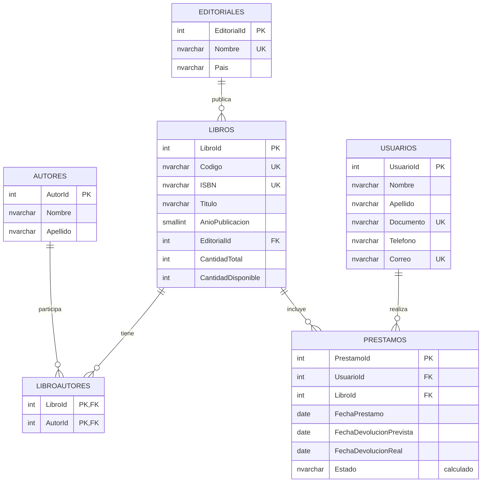

# Modelo de datos

Base de datos relacional: `SistemaGestionBiblioteca`.

## Diagrama entidad-relación

Un libro puede tener varios autores y un autor puede participar en varios libros; `LibroAutores` representa esa relación. La capa de negocio exigirá al menos un autor al registrar un libro. Un libro pertenece a una editorial. Los usuarios y los libros se relacionan mediante los préstamos. `Estado` se calcula a partir de `FechaDevolucionReal`: sin fecha significa `Prestado`; con fecha significa `Devuelto`.

## Diccionario de datos

| Tabla | Campo | Tipo | Obligatorio | Descripción |
|---|---|---|---|---|
| Autores | AutorId | int, identidad | Sí | Clave primaria del autor. |
| Autores | Nombre | nvarchar(80) | Sí | Nombres del autor. |
| Autores | Apellido | nvarchar(80) | Sí | Apellidos del autor. |
| Editoriales | EditorialId | int, identidad | Sí | Clave primaria de la editorial. |
| Editoriales | Nombre | nvarchar(120) | Sí, único | Nombre de la editorial. |
| Editoriales | Pais | nvarchar(80) | No | País de la editorial. |
| Libros | LibroId | int, identidad | Sí | Clave primaria del libro. |
| Libros | Codigo | nvarchar(20) | Sí, único | Código interno del libro. |
| Libros | ISBN | nvarchar(20) | No, único si se informa | ISBN del libro. |
| Libros | Titulo | nvarchar(200) | Sí | Título del libro. |
| Libros | AnioPublicacion | smallint | No | Año de publicación. |
| Libros | EditorialId | int | Sí, clave foránea | Editorial del libro. |
| Libros | CantidadTotal | int | Sí | Total de ejemplares registrados. |
| Libros | CantidadDisponible | int | Sí | Ejemplares disponibles para préstamo. |
| LibroAutores | LibroId | int | Sí, clave primaria y foránea | Libro relacionado con el autor. |
| LibroAutores | AutorId | int | Sí, clave primaria y foránea | Autor relacionado con el libro. |
| Usuarios | UsuarioId | int, identidad | Sí | Clave primaria del usuario. |
| Usuarios | Nombre | nvarchar(80) | Sí | Nombres del usuario. |
| Usuarios | Apellido | nvarchar(80) | Sí | Apellidos del usuario. |
| Usuarios | Documento | nvarchar(30) | Sí, único | Documento de identidad. |
| Usuarios | Telefono | nvarchar(30) | No | Teléfono de contacto. |
| Usuarios | Correo | nvarchar(254) | No, único si se informa | Correo electrónico. |
| Prestamos | PrestamoId | int, identidad | Sí | Clave primaria del préstamo. |
| Prestamos | UsuarioId | int | Sí, clave foránea | Usuario que realiza el préstamo. |
| Prestamos | LibroId | int | Sí, clave foránea | Libro prestado. |
| Prestamos | FechaPrestamo | date | Sí | Fecha del préstamo; por defecto, hoy. |
| Prestamos | FechaDevolucionPrevista | date | Sí | Fecha acordada para la devolución. |
| Prestamos | FechaDevolucionReal | date | No | Fecha efectiva de devolución. |
| Prestamos | Estado | calculado | Sí | `Prestado` o `Devuelto`, según la fecha real. |

Las claves primarias y foráneas, restricciones de unicidad y validaciones de fechas y existencias se implementan en `BaseDatos/01_CrearBaseDatos.sql`. La relación entre autores y libros restringe la eliminación de autores relacionados. El registro de un préstamo y la actualización de existencias deberán ejecutarse en una misma transacción desde la capa de datos.

## Datos de prueba

El script incorpora autores, editorial, usuario, libro con tres ejemplares y un préstamo activo de ejemplo. Puede ejecutarse nuevamente sin duplicar esos registros.
